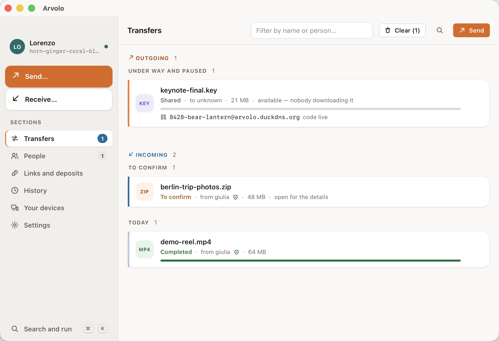

# Arvolo

*Leggilo in [italiano](README.it.md) · Lisez-le en [français](README.fr.md) ·
Lies es auf [Deutsch](README.de.md).*

**Send files to anyone — end-to-end encrypted, no account, even if they're
offline.**

## Try it in 60 seconds

One machine, nobody else needed.

**1. Install it.**

```sh
curl -fsSL https://raw.githubusercontent.com/lords82/arvolo/main/install.sh | sh
```

macOS and Linux; on Windows, and for the desktop app, see [Install](#install)
below.

**2. Send something.**

```sh
arvolo send --link ./report.pdf
#   ->  https://arvolo.duckdns.org/dl/7k2m…#Yk9f…
```

Open that URL in any browser, on any machine. The file downloads and decrypts
right there — no account on either side, nothing installed on theirs. This is
what whoever opens it sees:


That works out of the box because Arvolo ships pointed at a public relay. It
never sees your key — that lives only in the link's `#fragment`, which browsers
never send to a server — but it is a small machine run by the project: **files up
to 100 MB, links live for 6 hours**, and it can be busy. **For anything that
matters, point Arvolo at a relay you run** — [one `docker run`](#run-your-own-relay),
thirty seconds. A browser link is also the one path where the relay serves the
JavaScript that does the decrypting, which is a good reason for it to be yours.
Using the public one means accepting its [terms](TERMS.md) — short, and worth the
two minutes if what you send is not yours to send.

## Send to a person

The link is the demo. This is the daily use, and here the relay never sees the
file at all: it travels straight from your machine to theirs.

```sh
# you
arvolo send --code ./photo.jpg
#   ->  4821-crater-mango

# them
arvolo recv 4821-crater-mango
```

In the app: drag a file into the window and share the short code it gives you.



A bare `arvolo send ./photo.jpg` writes a small `photo.jpg.arvolo` ticket file
instead — share it over any channel, like a .torrent, and the other side runs
`arvolo recv photo.jpg.arvolo`.

And when they are not there at all, `arvolo send --to <them> ./photo.jpg` leaves
it **sealed** in a mailbox on the relay. It waits for them, then burns after
being read.

## Why not just…

| | |
|---|---|
| **magic-wormhole, croc** | Both sides have to be online at the same moment. Arvolo does that too, and when they're away it leaves the file sealed in a mailbox instead of failing. |
| **WeTransfer, Dropbox links** | Their server can read your file, and the account is theirs. Arvolo's relay only ever holds ciphertext, and you can run it yourself. |
| **Firefox Send** | Gone since 2020. `arvolo send --link` is the same idea — a link anyone can open in a browser — still here, and self-hostable. |
| **Syncthing** | Keeps folders in sync between machines you own. Arvolo sends one thing, once, to somebody else. |
| **Signal, email** | Fine, until the file is too big or the person isn't in your contacts. That's the gap this fills. |

## How it works

When both devices are online, files travel **peer-to-peer** — straight from one
machine to the other, never through a server. When the recipient is away, the
file waits **sealed** in a mailbox on a relay: a small server **you can
self-host**, which only ever stores ciphertext and cannot read a thing. And for
someone with nothing installed, a **link** downloads and decrypts the file in
any browser.

- **End-to-end encrypted, always** — keys never touch a server.
- **No account, no vendor in the middle** — your files move through
  infrastructure you control.
- **Reaches people who are offline** — sealed deposits wait for them, then burn
  after read.
- **App and command line, one engine** — macOS (signed and notarized), Windows
  and Linux.

## Install

| | |
|---|---|
| **macOS** | The `.dmg` from the [latest release](https://github.com/lords82/arvolo/releases/latest) — signed and notarized, no warnings — or the `curl … \| sh` line above for the command line. |
| **Linux** | The `.AppImage` for the app, `.deb` / `.rpm` for the command line, or the same one-liner. |
| **Windows** | The `.msi` from the [latest release](https://github.com/lords82/arvolo/releases/latest), which also puts `arvolo` on your `PATH`. Prefer to install nothing? Take the `.zip` and run it where it lands. |
| **From source** | `cargo install --git https://github.com/lords82/arvolo arvolo-cli` (Rust ≥ 1.88). |

The Windows installer isn't code-signed yet — an EV certificate costs a few
hundred euro a year — so SmartScreen will stop you once: **More info → Run
anyway**. Every release ships a `SHA256SUMS` if you would rather check what you
downloaded.

## Run your own relay

```sh
docker run -d --name arvolo-relay -p 6282:6282 -v arvolo-data:/data \
  ghcr.io/lords82/arvolo-relay:latest
```

Point Arvolo at it under **Settings → Network** in the app, or with `--relay` on
the command line. Then it is your files, your retention, your size limits, and
nothing of yours waits on somebody else's machine. [Deploying](docs/DEPLOY.md)
covers doing it properly, with TLS.

## Where to go next

| | |
|---|---|
| [The manual](docs/MANUAL.md) | Every command, every flag, every setting — and how it all works inside. |
| [Quickstart](docs/QUICKSTART.md) | Standing up a relay properly, LAN and behind nginx + TLS, end to end. |
| [Deploying](docs/DEPLOY.md) | Production self-hosting: systemd, Docker, abuse hardening. |
| [The desktop app](gui/README.md) | The GUI in detail, with its CLI parity table. |
| [The protocol](docs/PROTOCOL.md) | The wire format and every flow, for the curious and the auditing. |
| [Terms of use](TERMS.md) | The conditions of the public relay: what may not be sent, who answers for it, what is logged and for how long. |

## Security

No external audit yet, and the protocol is written down in full so that it can
have one — see [SECURITY.md](SECURITY.md) for what is and isn't reviewed, and
for how to report something privately.

## License

Open core: the client and the relay are free software under
[AGPL-3.0-only](LICENSE); a separate commercial license covers proprietary use
and business features. "Arvolo" is a trademark of the project owner — see
[CONTRIBUTING.md](CONTRIBUTING.md).
